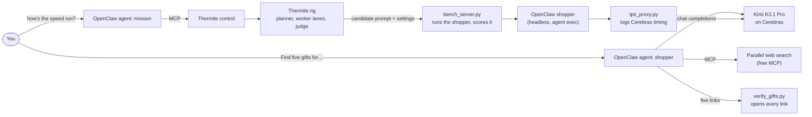

# Speedy Shopper

**An OpenClaw agent on Kimi K3.1 Pro (Cerebras) that finds five real Christmas gifts in seconds, and an autoresearch loop that makes it faster overnight.**

- **The shopper** is an [OpenClaw](https://openclaw.ai/) agent running on **Kimi K3.1 Pro on Cerebras**. Ask it "Find five Christmas gifts for a beginner photographer": it searches the web and answers with five products from real retailers, each with its product link. A verifier then opens every link to prove it's a live product page.
- **The tuner** is [Thermite](https://github.com/iammrduncan/thermite), an open-source autoresearch system. Its worker agents rewrite the shopper's instructions and request settings. Its judge reruns the shopper on gift briefs it picks at random, and keeps a change only if the shopper still finds five real gifts *and* Kimi's decode speed (tokens/sec) went up.
- **Mission control** is a second OpenClaw agent on Kimi. It has Thermite's tools, so you can ask it in chat how the speed run is going.

Built for the Cerebras × Moonshot AI **Kimi K3.1 Pro + OpenClaw Weekend Hackathon** (21–22 Nov 2026), including the 🎅 **Santa's Speedy Shopper** speed bounty. `#KimiOnCerebras`

---

## Contents

- [How it fits together](#how-it-fits-together)
- [How speed is measured](#how-speed-is-measured)
- [No made-up gifts](#no-made-up-gifts)
- [Hackathon requirements](#hackathon-requirements)
- [Repository layout](#repository-layout)
- [Prerequisites and setup](#prerequisites-and-setup)
- [Run the shopper](#run-the-shopper)
- [Run the hill climb](#run-the-hill-climb)
- [Results](#results)
- [Recording and submission](#recording-and-submission)
- [Troubleshooting](#troubleshooting)
- [Security notes](#security-notes)
- [Credits](#credits)

## How it fits together



- **Shopper** ([shopper/](shopper/)): its instructions (`AGENTS.md`) and request settings (`settings.json`). Its only tools are Parallel's `web_search` and `web_fetch`, reached through Parallel's free search MCP endpoint (no key). It answers with exactly five lines: `N. Product — price — retailer — link`.
- **Bench** ([scripts/shopper_bench.py](scripts/shopper_bench.py)): runs one shopper attempt headlessly with `openclaw agent exec --config config/shopper.json5`, through the TPS proxy, then scores and verifies it.
- **Thermite kit** ([kit/](kit/)) and contract ([thermite/contract.json](thermite/contract.json)): the hill climb. The judge runs inside Thermite's rig container and posts each candidate's `shopper/` files to the bench service on the host. Each judgement runs the candidate and the current champion on random briefs, paired (9 runs a side per verdict), and keeps a change only if the gain is clear of the noise. Held-out briefs check that a win isn't tuned to particular searches.
- **Mission control** ([agent/](agent/)): an OpenClaw agent whose only tools are 12 Thermite MCP tools.

## How speed is measured

We score speed exactly as the official OpenClaw speed patch does:

- Cerebras ends every streamed response with `usage.completion_tokens` and `time_info.completion_time` (server-side decode time).
- Each model call's rate is `completion_tokens / completion_time`, so queueing, prefill, network and tool time don't count.
- The headline is the **mean of the per-call rates** over the session; p90 is shown alongside.

[scripts/tps_proxy.py](scripts/tps_proxy.py) is a pass-through proxy to `api.cerebras.ai` that records those two numbers for every call, plus prompt and cache sizes. `python3 scripts/tps_proxy.py --summary runs/tps_calls.jsonl` prints the mean and p90.

What we saw on day one: identical requests decode at roughly 270–560 tokens/sec depending on shared load. Single samples can't rank one setting against another, which is why the judge repeats every measurement.

## No made-up gifts

The bounty disqualifies made-up, placeholder or hard-coded results. The bench treats an attempt as **valid** only if all of these hold:

1. The answer has exactly five distinct URLs.
2. Each URL is a live product page on a retail site, on at least two retailers. [scripts/verify_gifts.py](scripts/verify_gifts.py) fetches each one and looks for schema.org `Product` data, `og:type product`, price metadata, or a price beside a buy signal (add to basket, regular/sale price, stock, quantity). Shops that block scripts (403/429) are re-checked through Parallel's page fetcher. Big retailers that block both are accepted only when that run's own search result for the URL shows a price and a buy signal.
3. Every URL appeared in a tool result during that attempt. The proxy saves request bodies, so the bench can see exactly what the model was shown.
4. No URL is written in the candidate's own files. The contract also forbids URL patterns in `shopper/`.

Thermite only measures speed on valid runs.

## Hackathon requirements

| Requirement | How |
| --- | --- |
| Kimi K3.1 Pro on Cerebras as a central component | Every shopper and mission-control turn runs on `moonshotai-kimi-k3.1-pro-trial` |
| OpenClaw harness | The shopper and mission control are OpenClaw agents (gateway web chat, CLI, or `agent exec` headless) |
| Speed bounty task: five real Christmas gifts, with links | The shopper, checked by `verify_gifts.py` |
| TPS measured with the official patch | The bounty recording uses the patched OpenClaw in a separate checkout (not in this repo). Our proxy reproduces its formula for tuning |
| Public demo on standard OpenClaw | This repo's setup uses the stock `openclaw` npm package |
| Demo ≤ 60 s showing Cerebras speed | 58 s cut: a live shopper run, its measured TPS and verified links, `race.py` vs Moonshot's API, and the hill-climb results |

## Repository layout

```
.
├── README.md, PLAN.md, SPEED_GUIDE.md, SUBMISSION.md
├── shopper/                      the shopper agent's workspace (AGENTS.md, settings.json, tiny persona files)
├── agent/                        the mission-control agent's workspace
├── config/
│   ├── openclaw.example.json5    gateway config: Cerebras provider, both agents, Parallel + Thermite MCP
│   └── shopper.json5             pinned config for headless shopper runs (the bench)
├── kit/                          Thermite kit: build packs shopper/, run posts it to the bench, check reads the verdict
├── thermite/
│   ├── contract.json             hill-climb contract (metric mean_tps, max; editable: shopper/**)
│   └── seed/                     the project Thermite starts from (README for the worker agents + shopper/)
└── scripts/
    ├── tps_proxy.py              Cerebras pass-through proxy; per-call TPS like the speed patch
    ├── verify_gifts.py           checks five links are live product pages
    ├── parallel_mcp.py           tiny client for Parallel's free search MCP
    ├── shopper_bench.py          run + score + verify one or more shopper attempts
    ├── bench_server.py           HTTP front for the bench, for Thermite's judge (Docker bridge only)
    ├── make_thermite_repos.sh    build the seed and kit repos, bundles and assign payload
    ├── thermite_prepare.mjs      validate kit + contract with Thermite's own schema code
    ├── thermite_mcp.py           call any Thermite MCP tool from the shell
    ├── setup-openclaw.sh         install the gateway config and secrets file, restart the gateway
    ├── cerebras_smoke.py         one streamed request: TTFT and TPS
    ├── openclaw_smoke.sh         mission control → Thermite tool call, end to end
    └── record.sh                 screen capture to a ≤60 s 1080p MP4
```

## Prerequisites and setup

| Need | Version used |
| --- | --- |
| Linux (X11 for recording) | Ubuntu |
| Node.js | 24.22.3 via nvm (OpenClaw needs 24.16+) |
| OpenClaw | 2026.11.6 (`npm install -g openclaw@latest --allow-scripts=openclaw`) |
| Python | 3.9+, standard library only |
| Cerebras API key | with Kimi K3.1 Pro hackathon access |
| Thermite (for the hill climb) | 0.2.5 local stack, its source checkout for `thermite_prepare.mjs` |
| ffmpeg / OBS | 6.1 / 30 (recording) |

1. Install the gateway config and secrets file. The token path is only needed for mission control:

   ```bash
   scripts/setup-openclaw.sh /path/to/thermite/.dev/secrets/control-operator-token
   ```

   This writes `~/.openclaw/openclaw.json`, backs up any existing one, creates `~/.openclaw/.env` (mode 600) and restarts the `openclaw-gateway` user service on `127.0.0.1:18789`.
2. Put `CEREBRAS_API_KEY=...` in `~/.openclaw/.env`, then rerun the script (or restart the service).
3. Check Kimi:

   ```bash
   python3 scripts/cerebras_smoke.py --reasoning-effort low --quiet
   ```

## Run the shopper

**In chat:** run `openclaw dashboard`, open the web chat (it starts on **Speedy Shopper**) and ask for gifts.

**From the CLI, through the gateway:**

```bash
openclaw agent --agent shopper --message "Find five Christmas gifts for a cat owner."
```

**Benchmarked and verified (headless, through the TPS proxy):**

```bash
python3 scripts/tps_proxy.py --log runs/tps_calls.jsonl --dump-dir runs/dumps &
```
```bash
python3 scripts/shopper_bench.py --brief "a cat owner"
```
```bash
python3 scripts/shopper_bench.py --reps 6 --json > runs/bench.json
```

**Verify any answer:**

```bash
openclaw agent --agent shopper --json --message "Find five Christmas gifts for a gardener" | python3 -c 'import json,sys; print(json.load(sys.stdin)["payloads"][0]["text"])' | python3 scripts/verify_gifts.py -
```

## Run the hill climb

1. Start the proxy (above), then the bench service on the Docker bridge. It listens only on `172.17.0.1`, which Thermite's rig container reaches as `host.docker.internal`, and needs a shared token in `kit/.bench-token` (gitignored):

   ```bash
   openssl rand -hex 24 > kit/.bench-token
   ```
   ```bash
   python3 scripts/bench_server.py &
   ```
2. Build the repos, add the kit to control, drop the seed bundle in the rig's inbox and assign the run. `make_thermite_repos.sh` writes `runs/thermite/assign.json`:

   ```bash
   scripts/make_thermite_repos.sh speedy-shopper-1 /path/to/thermite/.dev/inbox
   ```
   ```bash
   python3 -c "import base64,json; json.dump({'name':'speedy-shopper-kit','bundle_base64':base64.b64encode(open('runs/thermite/speedy-shopper-kit.bundle','rb').read()).decode()}, open('runs/thermite/kit_add.json','w'))"
   ```
   ```bash
   python3 scripts/thermite_mcp.py call kit_add @runs/thermite/kit_add.json
   ```
   ```bash
   python3 -c "import json; json.dump({'kind':'assign_campaign','rig':'local-1','payload':json.load(open('runs/thermite/assign.json'))}, open('runs/thermite/issue.json','w'))"
   ```
   ```bash
   python3 scripts/thermite_mcp.py call issue_command @runs/thermite/issue.json
   ```
3. Watch it in Thermite's dashboard, or ask mission control:

   ```bash
   openclaw agent --agent mission --message "How is the speedy-shopper run going?"
   ```
4. Take the champion: copy its `shopper/AGENTS.md` and `settings.json` into [shopper/](shopper/). The gateway's shopper agent uses that workspace. Its `thinking` value maps to the agent's thinking level.

## Results

Overnight campaign `speedy-shopper-2`, Sat 19:22 → Sun ~13:25 GMT. Full verdict list and what we learned: [SPEED_GUIDE.md](SPEED_GUIDE.md).

| Configuration | Judged runs | Mean TPS | Notes |
| --- | --- | --- | --- |
| Starting point (seed), Thermite baseline | 9 valid of 9 | 382–514, mostly 443–475 | 2 model calls per attempt (search, then answer) |
| Seed on the patched OpenClaw web chat | 1 | 484 mean, 493 p90 (server) | 5/5 links verified live |
| Templated 10-query search (adopted, now in `shopper/`) | 18 paired vs 18 seed | 420–435 vs 398–401 (same windows) | +7.7% [+0.4%, +15.0%] pooled over two Thermite judgements; each alone was inconclusive, so Thermite didn't promote it |
| Patched web chat with adopted prompt (Sun 13:30 GMT) | 2 | 388 mean / 445 p90 (cat owner); **504 mean / 584 p90** (BBQ dad) | 5/5 links verified live both times; the 504 run is our Speed Bounty entry |
| Live-recorded patched take (Sun ~15:20 GMT) | 1 | 483 mean / 587 p90 (cat owner) | 5/5 links verified live |
| Public demo run (standard OpenClaw, Sun ~15:30 GMT) | 1 | 427 mean over 4 calls (home barista), from our proxy | 5/5 links verified live |

**Kimi K3.1 Pro decode speed by provider** (Sat 21 Nov, ~20:00 GMT; 600 output tokens at reasoning_effort low, client-side tokens/sec after the first token, one sample each via OpenRouter; Cerebras from our own runs the same evening):

| Provider | tok/s |
| --- | --- |
| **Cerebras** (hackathon trial endpoint, under heavy load) | **~300–560, typically ~450** |
| Amazon Bedrock | 400 |
| DigitalOcean, Nebius, Parasail | ~300 |
| InferenceNet, Wafer, PrimaLabs, Modal, Makora, River | 105–140 |
| DeepInfra, Decart, AkashML, Morph | 60–75 |
| Together, Alibaba, Fireworks | 42–49 |
| Moonshot AI (the model's own API) | 35 |

**Our comparison is Moonshot AI's own API**, the model's creator serving its own model, rather than the fastest or slowest third-party host. `scripts/race.py` runs the same prompt on Cerebras and on Moonshot's API (via OpenRouter, fallbacks off) side by side; `--gpu-provider NAME` races another host. First race (Sat, Cerebras under heavy load): Cerebras 269 tok/s vs Moonshot API 34 tok/s, 8× faster decoding. The race in the demo video (Sun): Cerebras 285 tok/s vs Moonshot API 30 tok/s, **9.6× faster decoding**. Both clocks start at each side's first token, because time spent queueing is about load, not inference speed. Queue time is still shown, labelled as excluded.

## Recording and submission

- `scripts/record.sh recordings/demo.mp4 1920x1080+0+0` records a region at 30 fps to 1080p H.264, stopping at 60 s. `recordings/` is gitignored. Hide notifications, keys and e-mail first.
- **Public demo (X, Reddit):** standard OpenClaw. Shows the shopper answering, the verifier's result for all five links, the race against Moonshot's API, and the hill-climb results. Queue waits are fast-forwarded on screen and labelled.
- **Speed bounty (Discord `#share-your-demo`):** run the shopper in the **patched** OpenClaw web chat (separate checkout). Show the mean tok/s readout and the five links, and write `Speed Bounty entry: N TPS` in the message.
- X post: project name, team handles, 2–4 sentence description, video, repo link, `@Cerebras @Kimi_Moonshot #KimiOnCerebras`. Reddit r/cerebras with the flair "Kimi K3.1 Pro Hackathon". Deadline **Sun 22 Nov 10:00 PT**.

## Troubleshooting

| Symptom | Cause and fix |
| --- | --- |
| Shopper runs take 30–100 s even though decode takes about 1 s | Queueing at Cerebras under shared load. It doesn't count towards TPS. |
| `only 4/5 verified product pages` | A shop blocked both fetchers, or the model chose a category/list page. Look at `links` in the bench's `--json` output. |
| `URLs not in any tool result` | The model edited or invented a URL. The attempt is invalid by design. |
| `no timed model calls` | The TPS proxy isn't running, or the bench points elsewhere (`--base-url`). |
| Agent run hangs with `rate_limit` | 100K tokens/min. Run one bench at a time; pause the Thermite run while recording. |
| Gateway won't start (exit 78) | `openclaw config validate` |

## Security notes

- No secrets in the repo: keys live in `~/.openclaw/.env` (mode 600) and reach configs through `${VAR}` references. The bench token is in gitignored `kit/.bench-token`.
- The gateway binds to loopback only. The bench service binds to the Docker bridge address only and checks a token. The proxy binds to loopback and never logs the `Authorization` header.
- Mission control holds Thermite's operator token, with a 12-tool filter that leaves out the tools that could start paid RunPod pods or change rig settings.
- Web pages and Thermite text are treated as data. The shopper's only tools are search and fetch, and the verifier runs outside the model.
- The official speed patch is not in this repo and must not be published.

## Credits

- [Cerebras](https://cerebras.ai/) inference and [Moonshot AI](https://www.moonshot.ai/)'s Kimi K3.1 Pro
- [OpenClaw](https://openclaw.ai/) (MIT)
- [Thermite](https://github.com/iammrduncan/thermite) (Apache-2.0)
- [Parallel](https://parallel.ai/) free search MCP
