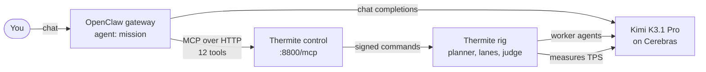

# Thermite Mission Control (working title)

**Chat with an AI agent that runs autoresearch campaigns at Cerebras speed.**

An [OpenClaw](https://openclaw.ai/) agent running on **Kimi K3.1 Pro on Cerebras** is mission control for [Thermite](https://github.com/iammrduncan/thermite), an open-source autoresearch system. You tell it what you want in plain words. It starts campaigns, reads the judge's verdicts, steers the agents and explains what happened. The demo campaign is a Thermite hill climb on the very thing Cerebras is known for: it searches for the prompt and request settings that get the most tokens per second out of Kimi K3.1 Pro.

Built for the Cerebras × Moonshot AI **Kimi K3.1 Pro + OpenClaw Weekend Hackathon** (21–22 Nov 2026). `#KimiOnCerebras`

> **Status: prepared, not built.** This repo holds the setup, configuration and test tooling made before the build window. The core project (the TPS kit, the mission-control behaviour and the demo) is built during the window: Sat 21 Nov 10:00 PT → Sun 22 Nov 10:00 PT. See [PLAN.md](PLAN.md).

---

## Contents

- [How it fits together](#how-it-fits-together)
- [Hackathon requirements and how we meet them](#hackathon-requirements-and-how-we-meet-them)
- [Repository layout](#repository-layout)
- [Prerequisites](#prerequisites)
- [Setup](#setup)
- [Verify the setup](#verify-the-setup)
- [Using mission control](#using-mission-control)
- [Token budget](#token-budget)
- [Recording the demo](#recording-the-demo)
- [Submission checklist](#submission-checklist)
- [Troubleshooting](#troubleshooting)
- [Security notes](#security-notes)
- [Credits](#credits)

## How it fits together



- **OpenClaw** is the harness and the interface. The `mission` agent runs on `cerebras/moonshotai-kimi-k3.1-pro-trial`, and its only tools are 12 Thermite MCP tools: read rigs, runs, attempts, queue, events, leaderboard and usage, plus start runs and issue commands.
- **Thermite** runs the experiments. A planner hands ideas to worker lanes, each lane proposes a change, and a judge the agents can't see or change measures it and keeps only wins that hold up.
- **Kimi K3.1 Pro on Cerebras** is central three times over: it drives the OpenClaw agent, it can drive Thermite's worker lanes, and it is the system under test in the TPS campaign.

## Hackathon requirements and how we meet them

| Requirement | How |
| --- | --- |
| Kimi K3.1 Pro on Cerebras as a central component | Mission-control agent, Thermite workers and the measured system are all Kimi on Cerebras |
| Use the OpenClaw harness | The whole user-facing loop is an OpenClaw agent (`openclaw agent --agent mission`, the Control UI or a channel) |
| Core functionality built during the window | Only setup, config and smoke tests exist before kickoff (see [PLAN.md](PLAN.md)) |
| Demo video ≤ 60 s showing Cerebras speed | `scripts/record.sh` caps at 60 s; side-by-side with a GPU-served model planned |
| X post tagging @Cerebras @Kimi_Moonshot with #KimiOnCerebras by Sun 10:00 PT | [Submission checklist](#submission-checklist) |

Model ID: `moonshotai-kimi-k3.1-pro-trial`, on the standard Cerebras API (`https://api.cerebras.ai/v1`). Reasoning is off by default; it is turned on with `reasoning_effort`. Hackathon access runs until Mon 23 Nov 10:00 PT at about 100 requests/min and 100K tokens/min per participant.

## Repository layout

```
.
├── README.md                     this file
├── PLAN.md                       idea, constraints, what's done, what's left for the build window
├── .env.example                  variables for the scripts (copy to .env, which is gitignored)
├── agent/                        workspace of the OpenClaw "mission" agent (kept tiny on purpose)
│   ├── AGENTS.md                 the agent's instructions
│   └── BOOTSTRAP.md IDENTITY.md SOUL.md USER.md   minimal stand-ins for OpenClaw's onboarding files
├── config/
│   └── openclaw.example.json5    OpenClaw config template (no secrets; __REPO__ is filled in on install)
└── scripts/
    ├── setup-openclaw.sh         install the config and secrets file, start the gateway
    ├── cerebras_smoke.py         one streamed request: time to first token and tokens/sec
    ├── openclaw_smoke.sh         end to end: OpenClaw agent → model → Thermite tool call
    └── record.sh                 record the screen to a ≤60 s 1080p MP4
```

## Prerequisites

| Need | Version used | Notes |
| --- | --- | --- |
| Linux with X11 | Ubuntu, X11 session | `record.sh` uses ffmpeg's `x11grab` |
| Node.js | 24.22.3 via nvm | OpenClaw needs Node 24.16+ or 26.1+ |
| OpenClaw | 2026.11.6 | `npm install -g openclaw@latest --allow-scripts=openclaw` |
| Thermite | 0.2.5, local stack | Control at `http://127.0.0.1:8800`; operator token in its `.dev/secrets/control-operator-token` |
| Python | 3.9+ | Standard library only |
| ffmpeg, OBS | 6.1, 30.0 | Recording |
| Cerebras account | Hackathon preview access | API key in `~/.openclaw/.env` |

## Setup

1. **Node 24 and OpenClaw**

   ```bash
   nvm install 24 && nvm alias default 24
   ```
   ```bash
   npm install -g openclaw@latest --allow-scripts=openclaw
   ```

2. **Thermite.** Start its local stack ([quick start](https://usethermite.com/tutorials/first-run/)) and check that `http://127.0.0.1:8800/ui` loads.

3. **OpenClaw config, secrets and gateway.** Pass the path to Thermite's operator token:

   ```bash
   scripts/setup-openclaw.sh /path/to/thermite/.dev/secrets/control-operator-token
   ```

   This writes `~/.openclaw/openclaw.json` from [config/openclaw.example.json5](config/openclaw.example.json5) and backs up any existing file. It creates `~/.openclaw/.env` (mode 600), installs the `openclaw-gateway` systemd user service on `127.0.0.1:18789`, and restarts it.

4. **Cerebras key.** Edit `~/.openclaw/.env` and set `CEREBRAS_API_KEY=...`, then restart the gateway:

   ```bash
   systemctl --user restart openclaw-gateway.service
   ```

5. **Thermite's own model (in the build window).** In Thermite's dashboard, add Cerebras under **Settings › Providers** as an OpenAI-compatible provider (`https://api.cerebras.ai/v1`), then set the rig's worker model to Kimi K3.1 Pro. Adding a provider needs the owner's sign-in. Note that a rig's models apply to every run on that rig.

## Verify the setup

```bash
python3 scripts/cerebras_smoke.py --list-models
```
```bash
python3 scripts/cerebras_smoke.py --quiet
```
```bash
scripts/openclaw_smoke.sh
```

- `cerebras_smoke.py` reads `CEREBRAS_API_KEY` from the environment or `./.env`. It reports time to first token, client-side tokens/sec, and server-side tokens/sec from Cerebras's `time_info.completion_time`. Use `--model`, `--prompt`, `--max-tokens` or `--reasoning-effort low|medium|high` to vary the request.
- `openclaw_smoke.sh [model]` asks the `mission` agent to call Thermite's `list_rigs`. With no argument it uses Kimi; pass `cerebras/gpt-oss-120b` to test the pipeline on a stand-in model.

Results on 20 Nov 2026, before Kimi preview access opened, with `gpt-oss-120b` as the stand-in:

| Check | Result |
| --- | --- |
| `cerebras_smoke.py --model gpt-oss-120b --reasoning-effort low` | 512 tokens, 275 ms to first token, ~1,400 tokens/s (server), ~1,480 tokens/s (client, after first token) |
| `openclaw_smoke.sh cerebras/gpt-oss-120b` | "Rig local-1 is live.", 1 Thermite tool call, 2.1 s end to end |
| Kimi `moonshotai-kimi-k3.1-pro-trial` | 404 `model_not_found`: preview access not yet live on the key |

## Using mission control

From the command line:

```bash
openclaw agent --agent mission --message "Which Thermite runs are live, and what's the best result so far?"
```

Or open the OpenClaw Control UI with `openclaw dashboard` (http://127.0.0.1:18789) and pick the **Mission control** agent. OpenClaw can also connect the agent to a chat channel (Telegram, Discord, Slack and others); see the OpenClaw docs.

What the agent can do through its 12 tools:

- **Look:** `list_rigs`, `get_run`, `get_attempt`, `run_queue`, `recent_events`, `leaderboard`, `model_usage`, `list_commands`, `command_status`, `kits`
- **Act:** `start_run` (a new run of a campaign Thermite keeps) and `issue_command` (pause, resume, redirect, message agents, and so on, within the operator token's rights)

Promotions that need the owner's approval stay with you: the operator token can't approve them.

## Token budget

Hackathon limits are about **100 requests/min and 100K tokens/min**. The free tier for the stand-in model is 5 requests/min and 30K tokens/min. Every part of the system shares that budget, so request size matters:

| Agent | Request size | Why |
| --- | --- | --- |
| OpenClaw default `main` | ~84 KB, ~21K tokens | Full system prompt, onboarding files, skills list; MCP tools hidden behind tool search (an extra round trip) |
| `mission` | ~25 KB, ~6–7K tokens | Only Thermite tools (`tools.allow: ["bundle-mcp"]`), `skills: []`, tool search off, minimal workspace files |
| All 68 Thermite tools | ~130 KB of schemas, ~33K tokens | Why `toolFilter.include` keeps only 12 |

Keep Thermite to one or two lanes during the event. The TPS kit's own measurement calls count against the same limit.

## Recording the demo

```bash
scripts/record.sh recordings/demo.mp4 1920x1080+0+0
```

- Records a region (`WxH+X+Y`) or the whole screen, at 30 fps, padded to 1080p H.264, and stops at 60 s (`SECONDS_MAX` to shorten). `recordings/` is gitignored.
- OBS is installed for anything more elaborate, such as a side-by-side layout with a GPU-served model.
- Before recording, hide notifications, unrelated browser tabs, terminals with keys, and e-mail.

What the video must show (≤ 60 s): Cerebras speed making a visible difference, ideally side by side with a GPU-based provider, plus the project's key workflow.

## Submission checklist

Deadline: **Sun 22 Nov 2026, 10:00 AM PT**. Engagement is counted Tue 24 Nov 10:00 AM PT.

- [ ] Demo video, 60 s or less
- [ ] Public GitHub repo (this one) with an updated README
- [ ] **X post (required):** project name, team handles, a 2–4 sentence description, the video, the repo link, tagging `@Cerebras` `@Kimi_Moonshot` and including `#KimiOnCerebras`
- [ ] **r/cerebras post (optional):** the same content, with the flair "Kimi K3.1 Pro Hackathon"
- [ ] TPS bounty entry: rules to be confirmed at kickoff or in `#hackathon-support`
- [ ] Organic engagement only: no paid promotion or boosting

## Troubleshooting

| Symptom | Cause and fix |
| --- | --- |
| `model_not_found` for `moonshotai-kimi-k3.1-pro-trial` | Preview access isn't on the key yet. Check `cerebras_smoke.py --list-models`; ask in `#hackathon-support` if it's still missing after kickoff. |
| Agent run hangs, gateway log shows `failoverReason=rate_limit` | Tokens-per-minute limit. Use `--agent mission`, not `main`; check headers with a direct request (`x-ratelimit-remaining-tokens-minute`). |
| `Secret ... CEREBRAS_API_KEY ... unavailable` | Key missing from `~/.openclaw/.env`, or the gateway wasn't restarted after adding it. |
| `openclaw mcp probe` says it needs exclusive offline state ownership | It only runs with the gateway stopped: `systemctl --user stop openclaw-gateway.service`, probe, then start it again. `openclaw gateway stop` doesn't stop the systemd service. |
| Gateway won't start (exit 78) | Invalid config: run `openclaw config validate`. |
| Logs | `journalctl --user -u openclaw-gateway.service -f` |

## Security notes

- No secrets are in this repo. `.env` files are gitignored. OpenClaw reads `CEREBRAS_API_KEY`, `THERMITE_MCP_TOKEN` and `OPENCLAW_GATEWAY_TOKEN` from `~/.openclaw/.env` (mode 600) through `${VAR}` references in its config.
- The OpenClaw gateway binds to loopback only and requires its token.
- The agent holds Thermite's **operator** token. The tool filter leaves out the tools that could start paid RunPod pods, change rig settings or reach the knowledge base. `issue_command` still acts on any run on the rig, so it can pause or redirect existing campaigns.
- Text Thermite returns (agent notes, queue items) is treated as data, and the agent's instructions say so.

## Credits

- [Cerebras](https://cerebras.ai/) inference and [Moonshot AI](https://www.moonshot.ai/)'s Kimi K3.1 Pro
- [OpenClaw](https://openclaw.ai/) (MIT)
- [Thermite](https://github.com/iammrduncan/thermite) (Apache-2.0)
